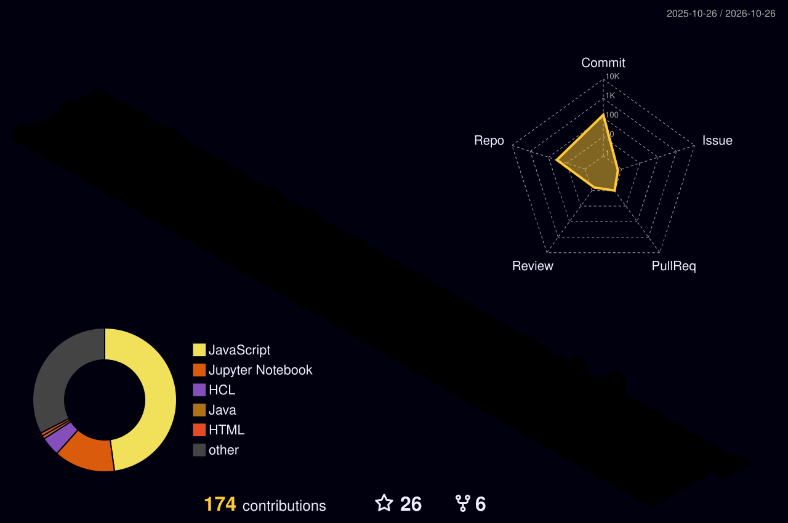
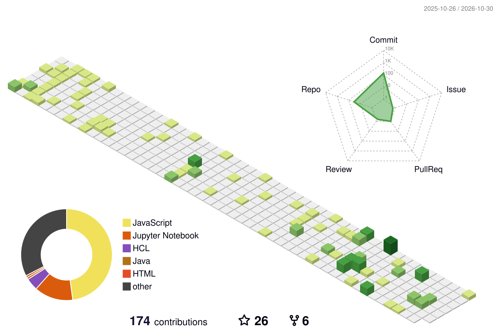

<!-- =========================================================
     MUKUL SHARMA | CLOUD • AI • FULL-STACK
     Repository: MukulSha-afk/MukulSha-afk
========================================================== -->

<h3>Cloud Architecture × Applied AI × Full-Stack Engineering</h3>

  Building useful products, exploring intelligent systems, and learning to engineer software that scales.

  
  
  

  
  
  

---

## 01 / A little about my engineering journey

I'm **Mukul Sharma**, a B.Tech student interested in the intersection of software engineering, cloud infrastructure, and artificial intelligence.

I enjoy moving beyond tutorials: understanding a problem, designing a solution, implementing it, debugging what breaks, and refining the result until the pieces work together.

My current engineering direction:

- **Full-stack development:** Turning product ideas into responsive, functional web applications.
- **Cloud engineering:** Learning to design, deploy, and operate applications using AWS.
- **Applied AI:** Exploring LLM-powered applications, Retrieval-Augmented Generation (RAG), and AI-assisted developer tools.
- **Problem solving:** Strengthening my foundations in DSA, C++, recursion, dynamic programming, and algorithmic thinking.

> My goal is to become the kind of engineer who can connect the frontend, backend, cloud infrastructure, and intelligence behind a product—not just work on one isolated layer.

---

## 02 / The technology landscape

**Frontend & Web**

**Backend, Databases & APIs**

**Cloud, Programming & Tools**

<table>
  <tr>
    <td width="33%" valign="top">

**Web Engineering**

- React & Next.js
- JavaScript & TypeScript
- Node.js & Express
- MongoDB & SQL
- REST API development

</td>
    <td width="33%" valign="top">

**Cloud & AI**

- AWS architecture
- Serverless patterns
- LLM & RAG concepts
- Python & AI/ML
- Deployment fundamentals

</td>
    <td width="33%" valign="top">

**Core Computer Science**

- C++ & DSA
- Recursion & DP
- Algorithm optimization
- Git & version control
- Debugging & testing

</td>
  </tr>
</table>

---

## 03 / Projects I’m building around

These projects reflect the problems and engineering areas I'm interested in. Their descriptions distinguish project concepts from implementation details; repositories are linked where available.

<table>
  <tr>
    <td width="50%" valign="top">

### ☁️ Cloud7

**A structured AWS learning experience**

A platform concept bringing learning paths, courses, mentors, quizzes, hands-on labs, and achievement badges together.

`Next.js` `TypeScript` `Tailwind CSS`

</td>
    <td width="50%" valign="top">

### 🤖 AI Code Review System

**Making code feedback more intelligent**

An AI-assisted code review application concept focused on surfacing potential bugs, security concerns, code-quality issues, and improvement suggestions.

`MERN` `Python` `LLMs` `AI/ML`

</td>
  </tr>
  <tr>
    <td width="50%" valign="top">

### 💧 AquaWatch

**Community water-quality reporting**

A community-focused application concept for reporting potentially unsafe water sources, following issue status, and viewing reports geographically. Inspired by UN Sustainable Development Goal 6.

`Flask` `SQLite` `JSON API`

</td>
    <td width="50%" valign="top">

### 📊 RedditPulse

**Data made easier to explore**

An interactive dashboard concept for presenting data-pipeline activity and information through a visualization-oriented interface.

`HTML` `JavaScript` `Data Visualization`

</td>
  </tr>
  <tr>
    <td width="50%" valign="top">

### 💼 Job Board Website

**A bridge between jobs and candidates**

A web application for publishing job opportunities and helping candidates browse and apply for relevant roles.

`HTML` `CSS` `JavaScript`

</td>
    <td width="50%" valign="top">

### 🌦️ Weather App

**A simple interface for weather information**

A lightweight web project focused on presenting weather data through a clear and responsive interface.

`HTML` `CSS` `JavaScript`

</td>
  </tr>
</table>

---

## 04 / AWS certifications

 

 

 

 

**Five certifications. One direction:** understanding cloud architecture, development, operations, and AI from complementary perspectives.

---

## 05 / LeetCode — the problem-solving lab

  

I use algorithmic problems to practice breaking complex tasks into smaller steps, comparing approaches, analyzing time and space complexity, and improving solutions.

**Areas I practice:** arrays, strings, recursion, dynamic programming, trees, and other core DSA patterns.

---

## 06 / GitHub analytics

  

---

## 07 / Contribution calendar

Small, consistent steps are how long-term engineering skills are built.

---

## 08 / The 3D contribution lab

<b>My GitHub activity, rendered in three dimensions.</b>

<!-- Generated automatically by .github/workflows/profile-3d.yml -->

  

---

---

## 09 / Contribution Snake

A little animation for the commits that keep the journey moving.

<picture>
  <source
    media="(prefers-color-scheme: dark)"
    srcset="https://raw.githubusercontent.com/MukulSha-afk/MukulSha-afk/output/github-snake-dark.svg"
  />
  <source
    media="(prefers-color-scheme: light)"
    srcset="https://raw.githubusercontent.com/MukulSha-afk/MukulSha-afk/output/github-snake.svg"
  />
  
</picture>

---

## 10 / What I'm working toward

I'm interested in engineering systems where good product design meets reliable infrastructure and useful intelligence.

My direction is to keep improving at:

- Designing and shipping full-stack applications.
- Building and deploying cloud-native solutions.
- Applying AI to real developer and user problems.
- Strengthening DSA and software engineering fundamentals.
- Collaborating on projects that solve meaningful problems.

### Let's turn an interesting idea into something real.

  

Curiosity in the design. Discipline in the implementation. Progress in every iteration.

